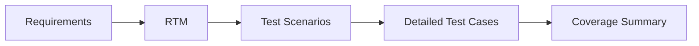

<div align="center">

# 🛒 Swag Labs (SauceDemo) — Manual Test Design

### Requirements • Traceability • Scenarios • Test Cases


</div>

---

## 📑 Table of Contents

- [About the Project](#-about-the-project)
- [Application Under Test](#-application-under-test)
- [Repository Structure](#-repository-structure)
- [Coverage](#-coverage)
- [Sample Test Cases](#-sample-test-cases)
- [Skills Demonstrated](#-skills-demonstrated)

---

## 🎯 About the Project

A manual QA test design for a public e-commerce demo store. Requirements are written in testable form, traced to scenarios and test cases in an RTM, and each test case carries its own preconditions, test data, steps and expected result.



**Project status:** test design is complete. Test execution and defect reporting are not part of this repository.

---

## 🌐 Application Under Test

| | |
|---|---|
| **Application** | Swag Labs — public demo store by Sauce Labs |
| **URL** | https://www.saucedemo.com |
| **Accounts used** | `standard_user`, `locked_out_user`, `problem_user` |

---

## 📂 Repository Structure

```text
SauceDemo-Manual-Test-Design/
├── 📊 SauceDemo_Test_Design.xlsx     ← RTM, TestCases, Coverage
├── 📁 docs/
│   └── 📘 Test_Plan.md               ← objective, scope, approach, criteria
└── 📘 README.md
```

### Workbook tabs

| Tab | Purpose |
|:---:|---|
| `RTM` | Six requirements mapped to scenarios and test cases |
| `TestCases` | 11 scenarios and 29 detailed test cases with preconditions, data, steps and expected results |
| `Coverage` | Auto-calculated totals per requirement, test type and priority, with a chart |

---

## 📊 Coverage

| ID | Feature | Total | Positive | Negative | Boundary |
|:---:|---|:---:|:---:|:---:|:---:|
| REQ-01 | Authentication | 6 | 1 | 4 | 1 |
| REQ-02 | Session & Access Control | 2 | 0 | 2 | 0 |
| REQ-03 | Product Browsing & Sorting | 6 | 6 | 0 | 0 |
| REQ-04 | Cart Management | 5 | 5 | 0 | 0 |
| REQ-05 | Checkout | 8 | 3 | 4 | 1 |
| REQ-06 | Menu, Logout & Reset | 2 | 2 | 0 | 0 |
| | **Total** | **29** | **17** | **10** | **2** |

| Priority | Test cases |
|:---:|:---:|
| High | 14 |
| Medium | 12 |
| Low | 3 |

**Techniques:** requirement-based testing, equivalence partitioning, boundary value analysis, error guessing and behaviour comparison between user accounts.

---

## 🧪 Sample Test Cases

<details>
<summary><b>TC-02 — Login with a wrong password (Negative)</b></summary>

<br>

| Field | Value |
|---|---|
| Requirement | REQ-01 / TS-02 |
| Priority | High |
| Test data | `standard_user` / `wrong_pass` |
| Steps | Enter the username → enter the wrong password → click Login |
| Expected | Login is refused, the user stays on the login page and sees the "Username and password do not match any user in this service" error |

</details>

<details>
<summary><b>TC-20 — Checkout with an empty cart (Negative)</b></summary>

<br>

| Field | Value |
|---|---|
| Requirement | REQ-05 / TS-09 |
| Priority | High |
| Test data | Cart: empty |
| Steps | Open the cart → click Checkout |
| Expected | Checkout is blocked, or the user is told the cart is empty |

</details>

<details>
<summary><b>TC-25 — Order total is calculated correctly (Positive)</b></summary>

<br>

| Field | Value |
|---|---|
| Requirement | REQ-05 / TS-10 |
| Priority | High |
| Test data | Backpack ($29.99) + Bike Light ($9.99) |
| Steps | Open cart → Checkout → fill the form → Continue → read the overview |
| Expected | Item total $39.98, tax $3.20 (8%), total $43.18 |

</details>

---

## 🧰 Skills Demonstrated

| Area | Details |
|---|---|
| Requirement analysis | Writing testable requirements for login, cart and checkout |
| Traceability | RTM linking requirements, scenarios and test cases |
| Test design | Positive, negative and boundary cases with data, steps and expected results |
| Documentation | Test plan, coverage summary and structured README |
| Tools | Microsoft Excel, Markdown, GitHub |
